- - -

# Coprocessador Gráfico 2D Programável em FPGA (DE1-SoC)

## Descrição do Projeto

Evolução do núcleo gráfico desenvolvido no Problema 1 para um **coprocessador gráfico programável**, inspirado na arquitetura de consoles clássicos de 16 bits. Na fase anterior, os motores de *background*, *sprites* e polígonos eram controlados por uma *MEF* acionada pelas chaves e botões da placa. Nesta fase, o núcleo passa a ser organizado como um processador: possui uma *ISA* própria de 32 bits, busca de instruções, registrador de instrução (*IR*), unidade de controle, *datapath*, bancos de registradores e registrador de status. Os motores gráficos passam a ser **unidades funcionais** do coprocessador, e toda alteração na cena acontece como consequência da execução de uma instrução.

As instruções são montadas por uma aplicação em C no processador ARM (*HPS*) da DE1-SoC e enviadas à FPGA por um *driver* em *Assembly* ARM, através da ponte *Lightweight HPS-to-FPGA* (*MMIO*). Na FPGA, as instruções são enfileiradas em uma *FIFO* e consumidas pela unidade de controle, caracterizando uma arquitetura de **busca passiva**.

## Contexto Acadêmico e Autoria

Este projeto foi desenvolvido como parte do componente curricular **TEC499 - MI Sistemas Digitais**, ministrado pelo professor **Wild Freitas da Silva Santos**, na **Universidade Estadual de Feira de Santana (UEFS)**, como parte da metodologia de Aprendizagem Baseada em Projetos (PBL).

**Equipe:**
* Airam Santos Macêdo ([@imthepassionfruit-lab](https://github.com/imthepassionfruit-lab));
* Nicolas Carvalho Pimentel ([@nicolascrp07](https://github.com/nicolascrp07));
* Walef Souza da Silva ([@walefsouza](https://github.com/walefsouza)).

## Sumário

1. [Requisitos Funcionais e Não Funcionais](#1-requisitos-funcionais-e-não-funcionais)
2. [Arquitetura Proposta e Justificativa](#2-arquitetura-proposta-e-justificativa)
3. [Software e Hardware para Prototipação](#3-software-e-hardware-usados-para-prototipação)
4. [Demonstração e Testes de Funcionamento](#4-demonstração-e-testes-de-funcionamento)
5. [Análise de Recursos da Plataforma](#5-análise-de-recursos-da-plataforma)
6. [Instalação e Configuração do Projeto](#6-instalação-e-configuração-do-projeto)
7. [Limitações e Possíveis Melhorias](#7-limitações-e-possíveis-melhorias)
8. [Referências Bibliográficas](#8-referências)

## 1. Requisitos Funcionais e Não Funcionais

### **1.1. Funcionais:**

* **RF01**: *ISA* de 32 bits com formatos de instrução, campos e codificação próprios, cobrindo controle, *background*, *sprites*, polígonos e compositor.
* **RF02**: Ciclo de busca/execução com unidade de busca, registrador de instrução (*IR*) e unidade de controle responsável pela decodificação.
* **RF03**: Busca passiva: as instruções chegam do processador ARM por uma fila de comandos alimentada pela interface *MMIO*.
* **RF04**: Registrador de status legível pelo ARM, com os sinais de comunicação *valid*, *busy* e *done*, além de *flags* de erro, *overflow* e estado da fila.
* **RF05**: Motores de *background*, *sprites* e polígonos do Problema 1 tratados como unidades funcionais, controlados exclusivamente por instruções.
* **RF06**: Mecanismo de sincronização com o VGA, permitindo que as alterações da cena aconteçam no início do *vertical blank* (instrução WAITVBLANK).
* **RF07**: Compositor, unidade de controle de quadro e controlador VGA operando continuamente, independentemente da execução das instruções.
* **RF08**: Detecção de instruções inválidas sem travar a unidade de controle nem perder o sincronismo de vídeo.
* **RF09**: *Driver* em *Assembly* ARM para comunicação entre o processador e o coprocessador.

### **1.2. Não Funcionais:**

* **RNF01**: Descrição integral do coprocessador em Verilog, com *driver* em *Assembly* ARMv7 e aplicação de teste em C.
* **RNF02**: Arquitetura modular, com separação entre fila de instruções, unidade de controle, bancos de registradores, motores gráficos, compositor, *frame buffer* e controlador VGA.
* **RNF03**: Saída de vídeo em 640×480 a 60 Hz sem instabilidade visual, perda de sincronismo ou *tearing*, mesmo durante o envio contínuo de instruções.
* **RNF04**: Fechamento de *timing* do domínio de 25 MHz do coprocessador, sem violações de *setup* e *hold*.
* **RNF05**: *Driver* mínimo e desacoplado da *ISA*, de modo que alterar ou acrescentar instruções não exija modificar o código *Assembly*.

## 2. Arquitetura Proposta e Justificativa

### 2.1. **Datapath**:

<div align="center">
  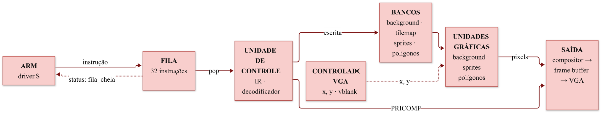
  <br>
  <i>Figura 1: Datapath do coprocessador gráfico.</i>
</div>
<br>

O ARM envia instruções de 32 bits para uma fila de 32 posições, e a *unidade de controle* as consome uma a uma. Cada instrução é decodificada e grava os atributos da cena nos bancos de registradores (fundo, *tilemap*, *sprites* e polígonos). As unidades gráficas leem esses bancos a cada pixel que o controlador VGA pede, o *compositor* junta as três camadas por prioridade e o *frame buffer* duplo entrega a imagem sem cortes ao monitor.

A arquitetura trabalha com duas partes em paralelo. A parte de **comando** (*FIFO*, unidade de controle e bancos) só avança quando há instruções na fila. A parte de **vídeo** (controlador VGA, motores, compositor, controle de quadro e *frame buffer*) opera ininterruptamente a 25 MHz, mesmo com a fila vazia ou com a UC ocupada. As duas partes se comunicam apenas pelos bancos de registradores, então a execução de uma instrução nunca interrompe a geração de vídeo.

### 2.2. **Instruction Set Architecture (ISA)**:

<div align="center">
  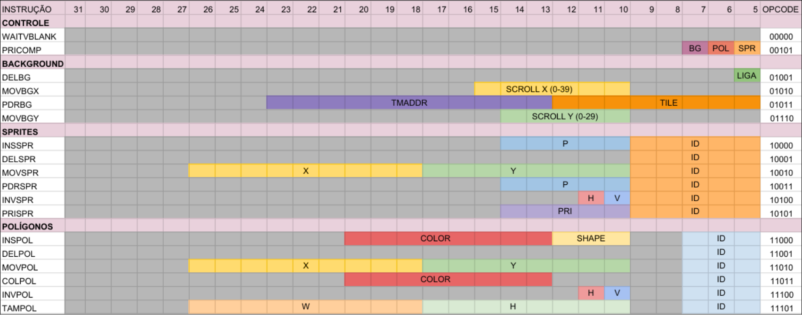
  <br>
  <i>Figura 2: Conjunto de instruções do coprocessador.</i>
</div>
<br>

O coprocessador possui **18 instruções de 32 bits**, todas com o *opcode* nos 5 bits menos significativos (**[4:0]**). Os dois bits mais significativos do *opcode* indicam o grupo da instrução, o que simplifica a decodificação na UC:

<div align="center">

Grupo | *opcode*[4:3] | Instruções
:---|:---|:---
Controle | 00 | WAITVBLANK, PRICOMP
*Background* | 01 | DELBG, MOVBGX, PDRBG, MOVBGY
*Sprites* | 10 | INSSPR, DELSPR, MOVSPR, PDRSPR, INVSPR, PRISPR
Polígonos | 11 | INSPOL, DELPOL, MOVPOL, COLPOL, INVPOL, TAMPOL

</div>

> [!NOTE]
> A *ISA* é composta apenas por comandos gráficos, sem instruções aritméticas ou de desvio. A lógica do programa (laços, decisões, cálculo de posições) fica no ARM, que envia ao coprocessador apenas o resultado na forma de instruções.

> [!WARNING]
> Qualquer *opcode* não listado é descartado pela UC e ativa a *flag* de erro do registrador de status. A *flag* permanece ativa até ser limpa pelo *driver*.

<details>
<summary><h3>Tabela de Instruções</h3></summary>

<div align="center">

*Opcode* | Hex | Instrução | Descrição
:---|:---|:---|:---
00000 | 0x00 | WAITVBLANK | Suspende a UC até o início do próximo *vblank*
00101 | 0x05 | PRICOMP | Define quais camadas são promovidas no compositor
01001 | 0x09 | DELBG | Liga ou desliga a camada de fundo
01010 | 0x0A | MOVBGX | *Scroll* horizontal do fundo, em *tiles* (0 a 39)
01011 | 0x0B | PDRBG | Grava o ID de um *tile* em uma posição do *tilemap*
01110 | 0x0E | MOVBGY | *Scroll* vertical do fundo, em *tiles* (0 a 29)
10000 | 0x10 | INSSPR | Ativa um *sprite* com o padrão indicado
10001 | 0x11 | DELSPR | Remove o *sprite*
10010 | 0x12 | MOVSPR | Move o *sprite* para (X, Y)
10011 | 0x13 | PDRSPR | Troca o padrão gráfico do *sprite*
10100 | 0x14 | INVSPR | Espelhamento horizontal/vertical do *sprite*
10101 | 0x15 | PRISPR | Define a prioridade do *sprite* (0 a 31)
11000 | 0x18 | INSPOL | Ativa um polígono com forma e cor
11001 | 0x19 | DELPOL | Remove o polígono e zera seu tamanho
11010 | 0x1A | MOVPOL | Move o polígono para (X, Y)
11011 | 0x1B | COLPOL | Troca a cor do polígono
11100 | 0x1C | INVPOL | Espelhamento horizontal/vertical do polígono
11101 | 0x1D | TAMPOL | Define largura e altura do polígono

</div>

</details>

<details>
<summary><h3>Instruções de Controle</h3></summary>

#### WAITVBLANK

<div align="center">

Nome do Campo | Descrição | Tamanho | Bit final | Bit inicial
:---|:---|:---|:---|:---
Opcode | Código da operação (00000) | 5 bits | 4 | 0
Não usados | | 27 bits | 31 | 5

</div>

Coloca a UC no estado ESPERA_VBLANK; as instruções seguintes permanecem na fila até o início do próximo *vertical blank*. É usada para animações sincronizadas com o quadro e como temporizador (1 WAITVBLANK ≈ 16,7 ms).

#### PRICOMP

<div align="center">

Nome do Campo | Descrição | Tamanho | Bit final | Bit inicial
:---|:---|:---|:---|:---
Opcode | Código da operação (00101) | 5 bits | 4 | 0
SPR | 1 promove a camada de *sprites* | 1 bit | 5 | 5
POL | 1 promove a camada de polígonos | 1 bit | 6 | 6
BG | 1 promove a camada de fundo | 1 bit | 7 | 7
Não usados | | 24 bits | 31 | 8

</div>

> **Nota:** Após o *reset*, nenhuma camada está promovida, valendo a ordem padrão *sprite* > polígono > fundo.

</details>

<details>
<summary><h3>Instruções de Background</h3></summary>

#### DELBG

<div align="center">

Nome do Campo | Descrição | Tamanho | Bit final | Bit inicial
:---|:---|:---|:---|:---
Opcode | Código da operação (01001) | 5 bits | 4 | 0
LIGA | 0 desliga, 1 liga o fundo | 1 bit | 5 | 5
Não usados | | 26 bits | 31 | 6

</div>

#### MOVBGX

<div align="center">

Nome do Campo | Descrição | Tamanho | Bit final | Bit inicial
:---|:---|:---|:---|:---
Opcode | Código da operação (01010) | 5 bits | 4 | 0
Não usados | | 5 bits | 9 | 5
X | Deslocamento horizontal em *tiles* | 6 bits | 15 | 10
Não usados | | 16 bits | 31 | 16

</div>

#### MOVBGY

<div align="center">

Nome do Campo | Descrição | Tamanho | Bit final | Bit inicial
:---|:---|:---|:---|:---
Opcode | Código da operação (01110) | 5 bits | 4 | 0
Não usados | | 5 bits | 9 | 5
Y | Deslocamento vertical em *tiles* | 5 bits | 14 | 10
Não usados | | 17 bits | 31 | 15

</div>

> **Nota:** Valores acima do tamanho do mapa são reduzidos pela UC antes da gravação (por exemplo, MOVBGX com 45 equivale a 5), garantindo que o *wraparound* sempre funcione.

#### PDRBG

<div align="center">

Nome do Campo | Descrição | Tamanho | Bit final | Bit inicial
:---|:---|:---|:---|:---
Opcode | Código da operação (01011) | 5 bits | 4 | 0
TILE | ID do *tile* a ser gravado | 8 bits | 12 | 5
END | Posição no *tilemap* (linha × 40 + coluna) | 11 bits | 23 | 13
Não usados | | 8 bits | 31 | 24

</div>

> **Nota:** As posições visíveis vão de 0 a 1199. Endereços de 1200 a 2047 são aceitos, mas não aparecem na tela.

</details>

<details>
<summary><h3>Instruções de Sprites</h3></summary>

Todas as instruções de *sprites* usam o ID nos bits [9:5] (0 a 31).

#### INSSPR, PDRSPR e PRISPR

<div align="center">

Nome do Campo | Descrição | Tamanho | Bit final | Bit inicial
:---|:---|:---|:---|:---
Opcode | 10000 (INSSPR), 10011 (PDRSPR) ou 10101 (PRISPR) | 5 bits | 4 | 0
ID | Índice do *sprite* | 5 bits | 9 | 5
OP | Padrão (INSSPR, PDRSPR) ou prioridade (PRISPR) | 5 bits | 14 | 10
Não usados | | 17 bits | 31 | 15

</div>

> **Atenção:** INSSPR ativa o *sprite* e zera posição, espelho e prioridade. Para que o *sprite* apareça no lugar desejado, deve-se sempre enviar MOVSPR depois de INSSPR.

#### DELSPR

<div align="center">

Nome do Campo | Descrição | Tamanho | Bit final | Bit inicial
:---|:---|:---|:---|:---
Opcode | Código da operação (10001) | 5 bits | 4 | 0
ID | Índice do *sprite* | 5 bits | 9 | 5
Não usados | | 22 bits | 31 | 10

</div>

#### MOVSPR

<div align="center">

Nome do Campo | Descrição | Tamanho | Bit final | Bit inicial
:---|:---|:---|:---|:---
Opcode | Código da operação (10010) | 5 bits | 4 | 0
ID | Índice do *sprite* | 5 bits | 9 | 5
Y | Posição vertical (0 a 255) | 8 bits | 17 | 10
X | Posição horizontal (0 a 511) | 9 bits | 26 | 18
Não usados | | 5 bits | 31 | 27

</div>

#### INVSPR

<div align="center">

Nome do Campo | Descrição | Tamanho | Bit final | Bit inicial
:---|:---|:---|:---|:---
Opcode | Código da operação (10100) | 5 bits | 4 | 0
ID | Índice do *sprite* | 5 bits | 9 | 5
V | Espelho vertical | 1 bit | 10 | 10
H | Espelho horizontal | 1 bit | 11 | 11
Não usados | | 20 bits | 31 | 12

</div>

</details>

<details>
<summary><h3>Instruções de Polígonos</h3></summary>

Todas as instruções de polígonos usam o ID nos bits [7:5] (0 a 7).

#### INSPOL

<div align="center">

Nome do Campo | Descrição | Tamanho | Bit final | Bit inicial
:---|:---|:---|:---|:---
Opcode | Código da operação (11000) | 5 bits | 4 | 0
ID | Índice do polígono | 3 bits | 7 | 5
Não usados | | 2 bits | 9 | 8
FORMA | 0 quadrado, 1 retângulo, 2 isósceles, 3 equilátero, 4 escaleno | 3 bits | 12 | 10
COR | Cor de 8 bits (RRRGGGBB) | 8 bits | 20 | 13
Não usados | | 11 bits | 31 | 21

</div>

#### COLPOL

<div align="center">

Nome do Campo | Descrição | Tamanho | Bit final | Bit inicial
:---|:---|:---|:---|:---
Opcode | Código da operação (11011) | 5 bits | 4 | 0
ID | Índice do polígono | 3 bits | 7 | 5
Não usados | | 5 bits | 12 | 8
COR | Nova cor de 8 bits (RRRGGGBB) | 8 bits | 20 | 13
Não usados | | 11 bits | 31 | 21

</div>

#### MOVPOL e TAMPOL

<div align="center">

Nome do Campo | Descrição | Tamanho | Bit final | Bit inicial
:---|:---|:---|:---|:---
Opcode | 11010 (MOVPOL) ou 11101 (TAMPOL) | 5 bits | 4 | 0
ID | Índice do polígono | 3 bits | 7 | 5
Não usados | | 2 bits | 9 | 8
B | Y (MOVPOL) ou altura H (TAMPOL), 0 a 255 | 8 bits | 17 | 10
A | X (MOVPOL) ou largura W (TAMPOL), 0 a 511 | 9 bits | 26 | 18
Não usados | | 5 bits | 31 | 27

</div>

#### INVPOL

<div align="center">

Nome do Campo | Descrição | Tamanho | Bit final | Bit inicial
:---|:---|:---|:---|:---
Opcode | Código da operação (11100) | 5 bits | 4 | 0
ID | Índice do polígono | 3 bits | 7 | 5
Não usados | | 2 bits | 9 | 8
V | Espelho vertical | 1 bit | 10 | 10
H | Espelho horizontal | 1 bit | 11 | 11
Não usados | | 20 bits | 31 | 12

</div>

#### DELPOL

<div align="center">

Nome do Campo | Descrição | Tamanho | Bit final | Bit inicial
:---|:---|:---|:---|:---
Opcode | Código da operação (11001) | 5 bits | 4 | 0
ID | Índice do polígono | 3 bits | 7 | 5
Não usados | | 24 bits | 31 | 8

</div>

> **Atenção:** DELPOL zera também o tamanho do polígono. Antes de reutilizar o mesmo ID, deve-se enviar um novo TAMPOL. A ordem recomendada é TAMPOL → INSPOL → MOVPOL, pois INSPOL zera a posição e o espelho, mas mantém o tamanho.

</details>

### 2.3. **Busca Passiva e PIOs**:

<div align="center">
  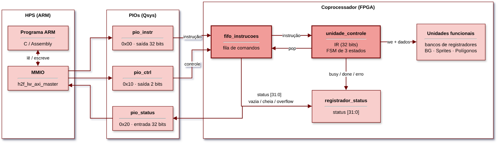
  <br>
  <i>Figura 3: Mecanismo de busca passiva de instruções.</i>
</div>
<br>

As instruções chegam do ARM por uma fila, e o coprocessador não possui memória de programa própria. A escolha pela busca passiva vem do produto final: o jogo em C roda no ARM, que já concentra a lógica de pontuação, entradas e colisões. Com um programa fixo em .mif dentro da FPGA, cada mudança na cena exigiria uma nova síntese; com a busca passiva, a mesma síntese serve a qualquer cena ou jogo. A *fifo_instrucoes* desacopla o ARM da UC, guardando os comandos até serem consumidos, e a UC só lê quando vazia = 0, guardando a instrução no *IR*. O ARM deve consultar o status antes de enviar, senão há *overflow*.

<div align="center">
  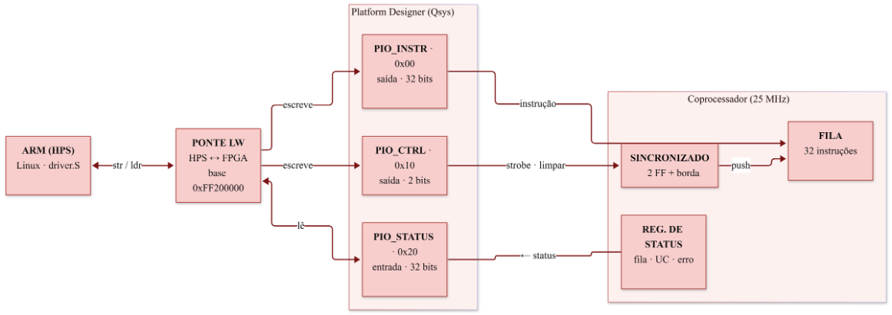
  <br>
  <i>Figura 4: PIOs criados no Platform Designer (Qsys).</i>
</div>
<br>

O ARM fala com a FPGA pela ponte *Lightweight HPS-to-FPGA*, que começa no endereço **0xFF200000**. No *Platform Designer* foram criados três PIOs:

<div align="center">

PIO | Offset | Direção | Função
:---|:---|:---|:---
PIO_INSTR | 0x00 | ARM → FPGA | Instrução de 32 bits
PIO_CTRL | 0x10 | ARM → FPGA | Bit 0: *strobe* de escrita na fila; bit 1: limpar erro
PIO_STATUS | 0x20 | FPGA → ARM | Estado da fila, da UC e do erro

</div>

Como o *HPS* e o coprocessador usam *clocks* diferentes, o *strobe* passa por um **sincronizador de 2 flip-flops** e por um **detector de borda de subida** antes de empurrar a instrução na fila. Assim, cada transição 0→1 do *strobe* gera exatamente um pulso de escrita, independentemente de quanto tempo o ARM mantenha o sinal em nível alto. O bit de limpar erro também passa por um sincronizador de 2 estágios.

### 2.4. **First In First Out (FIFO)**:

<div align="center">
  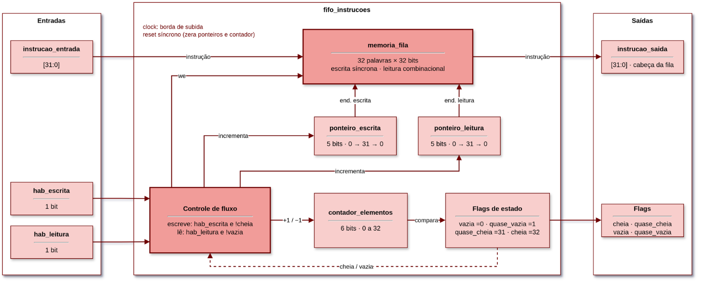
  <br>
  <i>Figura 5: Estrutura da fila de instruções.</i>
</div>
<br>

A fila guarda até **32 instruções de 32 bits** numa memória circular. A escrita grava no ponteiro de escrita e é ignorada se a fila estiver cheia. A saída instrucao_saida mostra sempre a palavra do ponteiro de leitura, e hab_leitura só avança esse ponteiro, sendo ignorada se a fila estiver vazia. Como a palavra já está disponível na saída antes da leitura, a UC captura a instrução no *IR* no mesmo ciclo em que avança a fila, sem ciclo extra de espera.

Um contador acompanha quantas instruções há na fila e gera as *flags* vazia, quase_vazia, quase_cheia e cheia, que voltam ao controle para barrar escrita e leitura indevidas. Leitura e escrita no mesmo ciclo mantêm o contador inalterado. O *reset* zera ponteiros e contador.

### 2.5. **Unidade de Controle**:

<div align="center">
  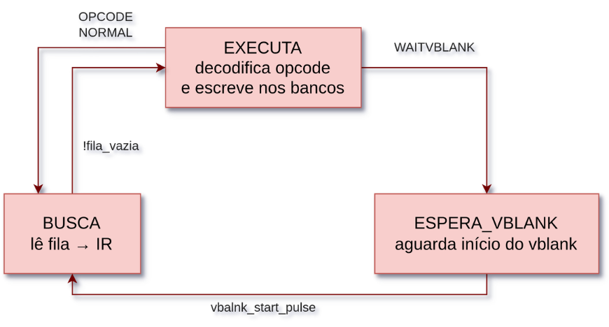
  <br>
  <i>Figura 6: Máquina de estados da unidade de controle.</i>
</div>
<br>

A *unidade_controle* implementa o ciclo de busca/execução com uma *FSM* de 3 estados:

<div align="center">

Estado | Função | Próximo estado
:---|:---|:---
**BUSCA** | Se a fila não estiver vazia, copia a instrução para o *IR* e avança a fila | EXECUTA
**EXECUTA** | Decodifica o *opcode* e gera a escrita no banco correspondente | BUSCA (ou ESPERA_VBLANK, se WAITVBLANK)
**ESPERA_VBLANK** | Mantém a UC parada até o pulso de início do *vblank* | BUSCA

</div>

* **IR:** registrador de instrução que guarda os 32 bits buscados da fila. Todos os campos (*opcode*, ID, coordenadas, cor, forma) são extraídos do *IR* por fatiamento de bits.
* **Decode por *case*:** o *opcode* define qual banco e qual campo são escritos.
* **Read-modify-write:** instruções que alteram um único campo (MOVSPR, PDRSPR, INVSPR, PRISPR, MOVPOL, COLPOL, INVPOL) leem a palavra atual do banco, alteram apenas aquele campo e regravam a palavra inteira, tudo em um ciclo.
* ***Strobe* de 1 ciclo:** os sinais de escrita dos bancos são zerados em todo ciclo e pulsam somente um ciclo após o EXECUTA, garantindo uma única escrita por instrução.
* **WAITVBLANK:** sincroniza a escrita com o *vblank*, evitando atualizar a cena no meio do quadro.
* **Opcode inválido:** cai no *default* do *case*, que descarta a instrução e gera um pulso de erro para o registrador de status. A UC volta normalmente para BUSCA.

Cada instrução gasta **2 ciclos de *clock*** (BUSCA + EXECUTA), exceto WAITVBLANK, que permanece parada até o início do próximo quadro.

### 2.6. **Registrador de Status e Handshake**:

<div align="center">
  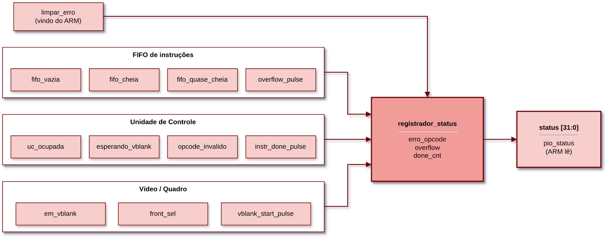
  <br>
  <i>Figura 7: Registrador de status e sinais de handshake.</i>
</div>
<br>

O *registrador_status* concentra em uma palavra de 32 bits, atualizada a cada ciclo, o estado do coprocessador, exposto ao ARM pelo PIO_STATUS:

<div align="center">

Bits | Campo | Descrição
:---|:---|:---
[0] | fifo_vazia | Fila sem instruções pendentes
[1] | fifo_cheia | Fila com 32 instruções
[2] | fifo_quase_cheia | Fila com 31 instruções
[3] | uc_ocupada | UC executando ou com instruções pendentes
[4] | esperando_vblank | UC parada em ESPERA_VBLANK
[5] | erro_opcode | Um *opcode* inválido foi descartado
[6] | em_vblank | Varredura dentro do *vertical blank*
[7] | front_sel | Página do *frame buffer* exibida no momento
[23:8] | contador_quadros | Contador de quadros de 16 bits
[24] | overflow | Houve tentativa de escrita com a fila cheia
[31:25] | done_cnt | Contador de instruções concluídas

</div>

Os sinais de *handshake* foram mapeados da seguinte forma:

* **valid** → !fifo_vazia: existe ao menos uma instrução aguardando a UC;
* **busy** → uc_ocupada: vale 0 somente quando a UC está parada em BUSCA com a fila vazia;
* **done** → instr_done_pulse + done_cnt: a cada conclusão, um contador é incrementado. Como o ARM lê o status por consulta e um pulso de 1 ciclo de 25 MHz poderia passar despercebido, optou-se por um contador em vez de um bit: o software compara duas leituras e sabe se houve conclusão entre elas.

> [!NOTE]
> As *flags* de erro e *overflow* permanecem em 1 até o comando de limpar erro (bit 1 do PIO_CTRL) ou o botão KEY1. Os LEDs LEDR[7:0] mostram os 8 bits menos significativos do status, e LEDR[9:8] piscam acompanhando o contador de quadros.

### 2.7. **Bancos de Registradores**:

Os bancos de registradores guardam o estado da cena e são a ligação entre a UC, que escreve, e os motores, que leem. Todos possuem escrita síncrona, *reset* síncrono e leitura assíncrona.

* **banco_background:** 8 registradores de 32 bits. O registrador 0 é o controle de vídeo (bit 0 = fundo desligado), o 1 guarda o *scroll* X e o 2 guarda o *scroll* Y. O *tilemap* de 40×30 posições fica em uma RAM de duas portas, escrita pela instrução PDRBG.
* **banco_sprites:** 32 registradores de 32 bits, um por *sprite*: [31] ativo; [30:26] padrão; [25] espelho H; [24] espelho V; [23:15] X; [14:7] Y; [6:2] prioridade; [1:0] livres. Possui uma porta de leitura individual, usada pelo *read-modify-write* da UC, e exporta o banco inteiro em um barramento de 1024 bits para o motor.
* **banco_poligonos:** 8 registradores de atributos de 32 bits ([31] ativo; [30:28] forma; [27:20] cor; [19] espelho H; [18] espelho V; [17:9] X; [8:1] Y) e um banco separado de 8 registradores de tamanho de 17 bits ([16:8] largura; [7:0] altura). No *reset*, o tamanho padrão é 50×50.

O tamanho dos polígonos ficou em um banco separado porque os 32 bits do registrador de atributos já estavam ocupados por posição, cor, forma e espelhamento. Assim, TAMPOL altera o tamanho sem tocar nos demais atributos.

### 2.8. **Motores Atualizados**:

O motor de *background* foi mantido como na fase 1, com *scroll* em unidades de *tile* e *wraparound* no mapa de 40×30. Os motores de *sprites* e polígonos foram reestruturados para atender aos 32 *sprites* com prioridade programável e aos 8 polígonos com tamanho variável.

**Motor de Sprites:** usa dois *line buffers* de 320 posições: um vai para a tela e o outro é montado para a próxima linha. Cada posição guarda a cor e a prioridade do *sprite* naquele pixel. A montagem de cada linha é feita por uma *FSM*:

* **OCIOSO:** espera o pulso de nova linha e guarda linha_alvo;
* **LIMPAR_LINHA:** zera cor e prioridade dos 320 pixels do *buffer* de escrita;
* **VARRE:** percorre os 32 *sprites* lendo o banco de registradores. Se o *sprite* está ativo e a linha cruza, guarda X, espelhos, padrão, prioridade e linha relativa;
* **DESENHA:** emite os 16 endereços da linha do *sprite* na ROM de padrões, com o espelhamento feito por inversão de bits (~), mais 2 ciclos para esvaziar o *pipeline*;
* **ESCRITA:** grava o pixel se a cor for diferente de 0, X < 320 e a prioridade for maior ou igual à já gravada naquele pixel. Ao fim dos 32 *sprites*, linha_pronta = 1.

Cada linha lógica dura duas linhas VGA (1600 ciclos), e o pior caso, com os 32 *sprites* na mesma linha, usa cerca de 930 ciclos. Por isso, **todos os 32 *sprites* podem ocupar a mesma linha sem que nenhum seja descartado**, o que resolve a limitação da fase 1, em que apenas dois *sprites* sobrepostos eram tratados.

> [!NOTE]
> **Prioridade entre *sprites*:** vence o *sprite* com maior valor de prioridade (PRISPR). Em caso de empate, vence o de maior ID.

**Rasterizador de Polígonos:** os 8 polígonos ficam no banco de registradores (atributos de 32 bits e tamanhos de 17 bits, em bancos separados), lido inteiro em paralelo a cada pixel. Cada polígono vira um quadrilátero de 4 vértices calculados só com somas e *shifts*, sem divisor; o triângulo é um quadrilátero com um vértice repetido.

<div align="center">

Forma | Código | Altura | Vértice superior
:---|:---|:---|:---
Quadrado | 0 | W | —
Retângulo | 1 | H | —
Triângulo isósceles | 2 | H | W/2
Triângulo equilátero | 3 | ≈ 0,86 × W | W/2
Triângulo escaleno | 4 | H | ≈ W/5

</div>

Para cada pixel, o hardware faz o produto vetorial entre cada aresta e o vetor até o pixel: **32 arestas e 64 multiplicações ao mesmo tempo**. O pixel está dentro se as 4 arestas derem o mesmo sinal. O espelhamento é feito refletindo os vértices dentro da área do polígono, e o resultado passa por dois estágios de *pipeline* para manter o alinhamento com as outras camadas.

> [!NOTE]
> **Prioridade entre polígonos:** entre polígonos sobrepostos, vence o de maior ID. Polígonos com largura ou altura menor que 2 pixels são descartados.

### 2.9. **Controle de Quadro, Compositor e Frame Buffer**:

* **Controle de quadro:** um detector de borda na linha 480 do contador vertical gera o pulso de início do *vblank*, usado para liberar a UC em ESPERA_VBLANK, trocar as páginas do *frame buffer* e incrementar o contador de quadros. Um segundo pulso, a cada duas linhas VGA, dispara a montagem da próxima linha no motor de *sprites*.
* **Compositor:** mistura as três camadas pixel a pixel, tratando o índice 0 como transparente. Nesta fase, a ordem das camadas passou a ser programável pela instrução PRICOMP: cada bit promove uma camada, e as promovidas ficam acima das não promovidas. Dentro de cada grupo vale a ordem padrão *sprite* > polígono > fundo, o que resulta em 8 combinações possíveis.
* ***Frame buffer*:** mantém o *double buffering* da fase 1, com duas RAMs de 320×240 pixels trocadas a cada *vblank*.
* **Controlador VGA:** inalterado em relação à fase 1 (640×480 a 60 Hz, saída ampliada 2×2).

### 2.10. **Top-Level (ghrd_top)**:

O ghrd_top integra o sistema *HPS* gerado pelo *Platform Designer* (soc_system) ao coprocessador. O CLOCK_50 é dividido por dois para gerar o *clock* de 25 MHz (clk_25) que alimenta todo o coprocessador, e o botão KEY0 funciona como *reset*. O *top-level* instancia a *FIFO*, a UC, os bancos, os motores, o compositor, o *frame buffer* e o registrador de status, além dos sincronizadores dos sinais vindos dos PIOs.

### 2.11. **Driver em Assembly**:

<div align="center">
  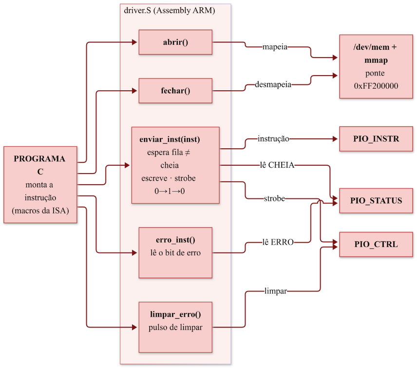
  <br>
  <i>Figura 8: Funções do driver em Assembly ARM.</i>
</div>
<br>

O *driver* em *Assembly* ARM só transporta palavras de 32 bits entre o ARM e a FPGA; quem monta as instruções é o programa em C. As funções disponíveis são:

<div align="center">

Função | Descrição
:---|:---
abrir() | Mapeia a ponte com /dev/mem e mmap. Retorna 0 (ok) ou −1 (erro)
fechar() | Desmapeia a ponte e fecha o arquivo
enviar_inst(inst) | Espera a fila ter espaço, escreve a instrução e gera o pulso de *strobe*
erro_inst() | Lê o bit de erro do status (1 = erro)
limpar_erro() | Zera as *flags* de erro e *overflow*

</div>

> [!NOTE]
> **Decisão de projeto:** o *driver* é mínimo e não conhece a *ISA*. Assim, mudar ou acrescentar uma instrução não exige mexer no *Assembly*, só nas macros em C que montam as palavras de 32 bits.

O ponto crítico é o *strobe*: o ARM é muito mais rápido que o *clock* de 25 MHz do coprocessador, então o *driver* segura o sinal em alto e em baixo por 16 leituras da ponte cada, para a FPGA enxergar a borda. Antes de cada envio, ele também confere se a fila tem espaço, o que evita perder instruções.

## 3. Software e Hardware usados para Prototipação

* **Plataforma Física:** Kit acadêmico Terasic DE1-SoC, FPGA Intel Cyclone V SoC 5CSEMA5F31C6, com processador ARM Cortex-A9 (*HPS*);
* **Módulos de Armazenamento:** Blocos dedicados de SRAM internos do chip (M10K);
* **Linguagens:** Verilog-2001 (coprocessador), *Assembly* ARMv7 (*driver*) e C (aplicação de teste);
* **Ferramentas de Síntese e Lógica:** Intel Quartus Prime Lite Edition para compilação, pinagem e mapeamento, e *Platform Designer* (Qsys) para os PIOs;
* **Compilação do Software:** GCC no Linux embarcado da DE1-SoC;
* **Interface Visual:** Monitor Philips com barramento analógico VGA padrão (640x480 @ 60Hz).

## 4. Demonstração e Testes de Funcionamento

Os testes foram feitos com o programa **teste.c**, executado no ARM e usando apenas o *driver* (driver.s / driver.h). O programa divide a validação em **10 etapas**, do mais simples ao mais complexo e sem nenhum valor aleatório. Antes de cada passo, ele informa no terminal o que vai fazer, envia as instruções e pergunta se o resultado esperado apareceu no monitor (s/n). Passos que podem ser conferidos pelo próprio programa, como o bit de erro, são verificados automaticamente, e ao final é exibido um resumo com as etapas aprovadas.

Antes de cada etapa, a cena volta ao estado inicial (fundo ligado e parado, compositor no padrão, nenhum *sprite* ou polígono ativo) e o erro é limpo. Ao fim de cada etapa, o programa confere se nenhum erro foi sinalizado.

<div align="center">

Etapa | Nome | O que é testado
:---|:---|:---
0 | Comunicação | Envio de instrução válida, *opcodes* inexistentes e limpeza do erro
1 | *Background* | Liga/desliga, troca de *tiles* e *scroll* com volta completa
2 | Um *sprite* | Criação, movimento, troca de padrão, espelhamento e remoção
3 | Vários *sprites* | Prioridade entre *sprites* e 32 *sprites* na mesma linha
4 | Um polígono | Formas, tamanho, cor, espelhamento e movimento
5 | Vários polígonos | 8 polígonos, sobreposição e recorte nas bordas
6 | Compositor | As 8 combinações de PRICOMP
7 | Animação sincronizada | Movimento quadro a quadro com WAITVBLANK
8 | Casos extremos | Limites de posição, tamanho e endereços
9 | Integração | Todas as unidades funcionais ao mesmo tempo

</div>

### 4.1. Comunicação e Comandos Inválidos

A etapa 0 é automática. Após uma instrução válida, o programa confere que o erro está em 0; após os *opcodes* inexistentes 0x1F, 0x01, 0x03 e 0x1E, confere que o erro foi para 1; e após limpar_erro(), confere que voltou a 0. Em todos os casos, a UC descarta a instrução inválida e continua executando as seguintes, sem travar e sem afetar o vídeo.

### 4.2. Motor de Background

Desliga e religa o fundo, pinta uma linha inteira com tijolos e as pontas de outra linha, e rola o cenário 1 *tile* por vez nos eixos X (0 a 39) e Y (0 a 29). **Esperado:** o cenário some e volta, a faixa de tijolos atravessa a tela e o *scroll* dá a volta completa no mapa.

<div align="center">
  
  <br>
  <i>Gif 1: Testes do motor de background.</i>
</div>
<br>

### 4.3. Um Sprite

Cria um *sprite* no centro, leva-o aos quatro cantos, troca o padrão 5 vezes, aplica espelho horizontal, vertical e nenhum, e o apaga. **Esperado:** o *sprite* percorre os cantos, muda de desenho sem mudar de lugar, inverte corretamente e some.

<div align="center">
  
  <br>
  <i>Gif 2: Criação, movimento, troca de padrão e espelhamento de um sprite.</i>
</div>
<br>

### 4.4. Vários Sprites e Prioridade

Sobrepõe dois *sprites* com prioridades 31 e 0 e depois inverte as prioridades. Em seguida, coloca os 32 *sprites* lado a lado na mesma linha e depois em uma grade 8×4. **Esperado:** o *sprite* de maior prioridade fica por cima; na mesma linha, nenhum *sprite* é perdido e o último aparece cortado na borda direita.

<div align="center">
  
  <br>
  <i>Gif 3: Prioridade entre sprites e 32 sprites simultâneos.</i>
</div>
<br>

### 4.5. Um Polígono

Desenha um quadrado vermelho, troca para retângulo e para triângulo, muda a cor para verde e azul, espelha nos dois eixos, move para o canto e apaga. **Esperado:** as formas aparecem com o tamanho definido, mudam de cor e invertem corretamente.

<div align="center">
  
  <br>
  <i>Gif 4: Formas, cor, espelhamento e movimento de um polígono.</i>
</div>
<br>

### 4.6. Vários Polígonos

Desenha os 8 polígonos separados, depois empilhados em escada e, por fim, três polígonos parcialmente fora da tela. **Esperado:** na escada, o polígono de maior ID cobre o de menor ID; nas bordas, os polígonos aparecem cortados, sem reaparecer do outro lado.

<div align="center">
  
  <br>
  <i>Gif 5: Sobreposição e recorte de polígonos.</i>
</div>
<br>

### 4.7. Compositor

Monta um retângulo azul com três *sprites* sobre ele e percorre as 8 combinações de PRICOMP. **Esperado:** no padrão, os *sprites* ficam sobre o polígono; promovendo os polígonos, eles cobrem os *sprites*; promovendo o fundo, ele cobre tudo; com tudo promovido, o resultado volta a ser igual ao padrão.

<div align="center">
  
  <br>
  <i>Gif 6: As 8 combinações de prioridade do compositor.</i>
</div>
<br>

### 4.8. Animação Sincronizada

Move um *sprite* 1 pixel por quadro ao longo da tela, move um quadrado trocando de cor a cada quadro e anima os 32 *sprites* descendo juntos. Cada quadro começa com um WAITVBLANK. **Esperado:** movimento liso, sem saltos, tremidos ou *sprites* piscando.

<div align="center">
  
  <br>
  <i>Gif 7: Animações sincronizadas com WAITVBLANK.</i>
</div>
<br>

### 4.9. Casos Extremos

Leva um *sprite* para fora da tela pela direita e por baixo, desenha um polígono do tamanho da tela e do tamanho máximo da *ISA* (511×255), testa os tamanhos mínimos (1×1 e 2×2), posiciona um polígono totalmente fora da tela, envia *scroll* além do mapa e grava *tiles* fora da área visível. **Esperado:** o *sprite* sai cortado e não reaparece do outro lado; a tela fica inteira azul e depois vermelha, sem perder sincronismo; o 1×1 é descartado e o 2×2 aparece; o *scroll* além do mapa equivale ao valor dentro do mapa; nada muda no cenário visível com os *tiles* fora da área.

<div align="center">
  
  <br>
  <i>Gif 8: Limites de hardware e casos extremos.</i>
</div>
<br>

### 4.10. Integração

Durante cerca de 6 s, o fundo rola, *tiles* são desenhados um a um, 8 *sprites* cruzam a tela, 4 polígonos trocam de cor e, a cada 2 s, os polígonos alternam entre ficar abaixo e acima dos *sprites*. **Esperado:** cena fluida, sem perda de instruções nem erro sinalizado.

<div align="center">
  
  <br>
  <i>Gif 9: Integração de todas as unidades funcionais.</i>
</div>
<br>

## 5. Análise de Recursos da Plataforma

<div align="center">
  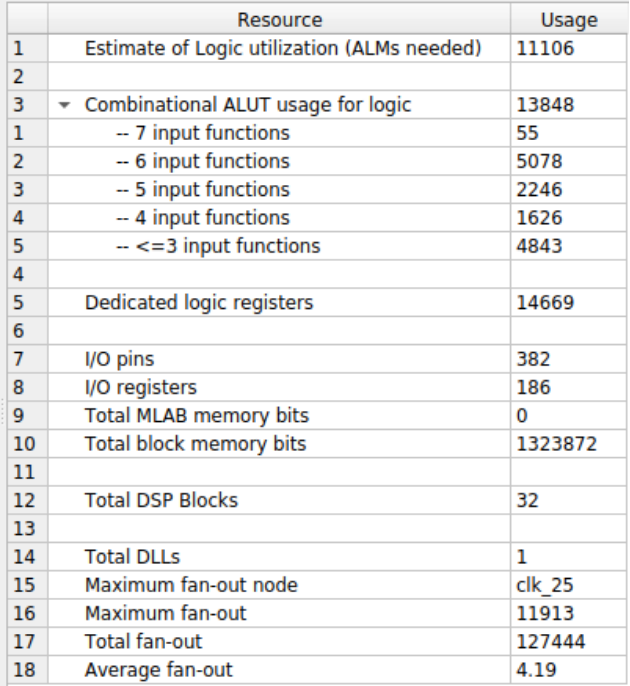
  <br>
  <i>Figura 9: Resource Usage Summary, Quartus Prime Lite Edition.</i>
</div>
<br>

- **Utilização de Lógica:**
  Foram utilizados 11.106 ALMs de 32.070 disponíveis, cerca de 35% da capacidade total (contra 10% na fase 1). O aumento vem principalmente dos bancos de registradores lidos em paralelo pelos motores, dos *line buffers* do motor de *sprites* e do sistema *HPS*.

- **Uso de Registradores:**
  O projeto utiliza 14.669 registradores, distribuídos entre a *FIFO*, os bancos de registradores, os *line buffers* de cor e prioridade, o pré-cálculo das arestas do rasterizador e a lógica do *HPS*.

- **Pinos Utilizados:**
  Foram utilizados 382 pinos (84% dos 457 disponíveis), aumento causado pela inclusão das interfaces do *HPS* (DDR3, Ethernet, USB, cartão SD etc.) no *top-level*.

- **Blocos de Memória:**
  Foram utilizados 1.323.872 bits dos 4.065.280 disponíveis (33%). Os dois *frame buffers* ocupam cerca de 93% dessa memória.

- **Blocos DSP:**
  Foram utilizados 32 blocos DSP (37% dos 87 disponíveis), o dobro da fase 1, todos aplicados nas 64 multiplicações simultâneas do rasterizador de polígonos.

- **Análise de Timing e Frequência Máxima (Fmax):**
  O *Timing Analyzer* não apontou violações de *setup* nem de *hold* em nenhum domínio de *clock*. No domínio clk_25, que alimenta todo o coprocessador, a folga de pior caso foi de 6,647 ns em *setup* e 0,169 ns em *hold*, e a Fmax atingiu **48,2 MHz** para os 25 MHz exigidos pela varredura VGA, uma folga de aproximadamente **1,9x**. Em relação à fase 1 (53,82 MHz), houve uma pequena redução, causada pelo aumento da lógica entre registradores no rasterizador e na decodificação da UC.

<div align="center">
  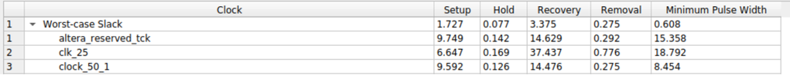
  <br>
  <i>Figura 10: Multicorner Timing Analysis Summary.</i>
</div>
<br>

<div align="center">
  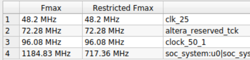
  <br>
  <i>Figura 11: Frequência máxima atestada no Timing Analyzer.</i>
</div>
<br>

- **Desempenho e Gargalos:**
  Cada instrução gasta 2 ciclos de 25 MHz na UC, e a etapa de animação, com 33 instruções por quadro, rodou de forma fluida. Quando há WAITVBLANK na fila, o ARM fica bloqueado assim que a fila enche, o que, na prática, sincroniza o programa em C com o quadro sem nenhum código extra. No motor de *sprites*, o pior caso usa cerca de 58% do tempo disponível por linha, e o rasterizador tem custo constante, independentemente do tamanho dos polígonos. O principal gargalo do projeto é a memória: os dois *frame buffers* ocupam cerca de 93% dos blocos de memória utilizados, o que limita a inclusão de novos recursos gráficos que dependam de memória interna.

## 6. Instalação e Configuração do Projeto

### Pré-requisitos:

- Ter o software Quartus Prime (Standard ou Lite Edition) instalado;
- Driver USB-Blaster instalado e reconhecido pelo sistema operacional;
- Placa DE1-SoC conectada via cabo USB-Blaster e saída VGA conectada a um monitor;
- Linux embarcado da DE1-SoC em execução, com acesso ao terminal e GCC disponível.

### Passos (hardware):

1. Baixe o diretório do projeto e abra o arquivo soc_system.qpf no Quartus Prime.
2. Certifique-se de que os arquivos .mif (padrões gráficos e *tilemaps*) permanecem no mesmo diretório do projeto, pois são usados para a inicialização das memórias durante a síntese.
3. As IPs de memória (RAMs e ROMs *Dual-Port*, buffers de frame) e os PIOs do *Platform Designer* já estão configurados, não sendo necessário reconfigurá-los manualmente.
4. Envie o projeto à síntese clicando em **Processing > Start Compilation**.
5. Após a compilação bem-sucedida, abra o **Programmer**, selecione o cabo USB-Blaster e clique em "Start" para gravar o projeto na FPGA.

### Passos (software):

1. Copie os arquivos driver.s, driver.h e teste.c para o Linux da placa.
2. Compile o programa junto com o *driver*:
   ```bash
   gcc teste.c driver.s -o teste
   ```
3. Execute com permissão de administrador, necessária para acessar /dev/mem:
   ```bash
   sudo ./teste        # executa todas as etapas
   sudo ./teste 4      # executa apenas a etapa 4
   ```

## 7. Limitações e Possíveis Melhorias

O projeto apresenta algumas limitações, decorrentes de decisões de escopo tomadas para viabilizar a entrega dentro do prazo. A seguir, cada limitação é acompanhada de uma possível melhoria futura:

- **Sem ULA dedicada (decisão de projeto):**
  A *ISA* é composta apenas por comandos gráficos, sem aritmética nem desvios, e os cálculos necessários ficam distribuídos na UC e nos motores. Uma melhoria seria acrescentar uma ULA e instruções que operem sobre os registradores da cena, como mover um *sprite* de forma relativa sem que o ARM precise guardar sua posição.

- **Datapath integrado à Unidade de Controle (decisão de projeto):**
  A seleção dos campos do *IR* para os bancos é feita dentro da própria UC. Separá-la em um módulo próprio tornaria a arquitetura mais próxima de um processador convencional e facilitaria a inclusão de uma ULA.

- **Validação com o jogo:**
  O próximo passo é desenvolver o jogo em C já idealizado, que utilizará o *driver* e a *ISA* desenvolvidos nesta fase para validar a integração final entre o processador ARM e o coprocessador.

## 8. Referências

ADAMS, V. Hunter. VGA Driver in Verilog. [S. l.], [s. d.]. Disponível em: https://vanhunteradams.com/DE1/VGA_Driver/Driver.html. Acesso em: 17 ago. 2026.

CHU, Pong P. FPGA prototyping by Verilog examples: Xilinx Spartan-3 version. Hoboken, NJ: John Wiley & Sons, 2008.

CHU, Pong P. FPGA prototyping by SystemVerilog examples: Xilinx MicroBlaze MCS SoC edition. 2. ed. Hoboken, NJ: Wiley, 2018.

PATTERSON, David A.; HENNESSY, John L. Computer organization and design: the hardware/software interface: ARM edition. Waltham, MA: Morgan Kaufmann, 2017.

TOCCI, Ronald J.; WIDMER, Neal S.; MOSS, Gregory L. Sistemas digitais: princípios e aplicações. 11. ed. São Paulo: Pearson Prentice Hall, 2011. Tradução de Jorge Ritter; revisão técnica de Renato Giacomini.
